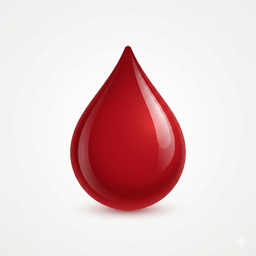
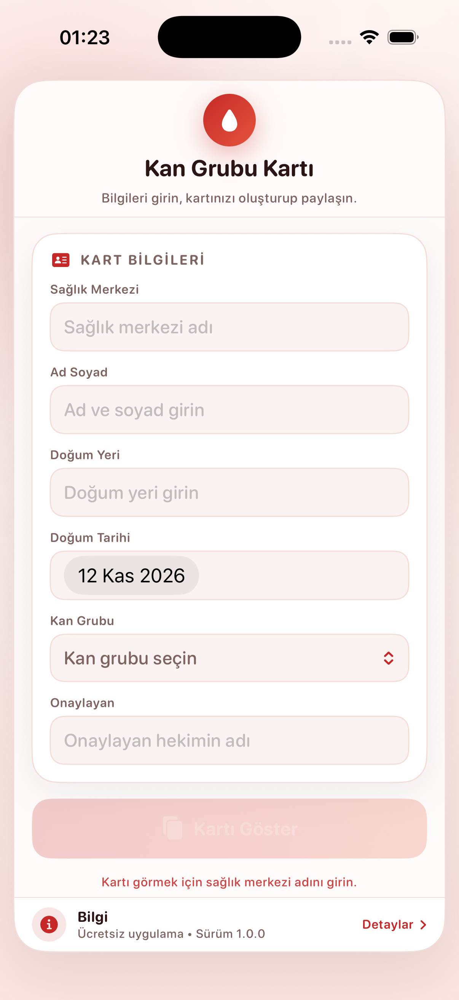
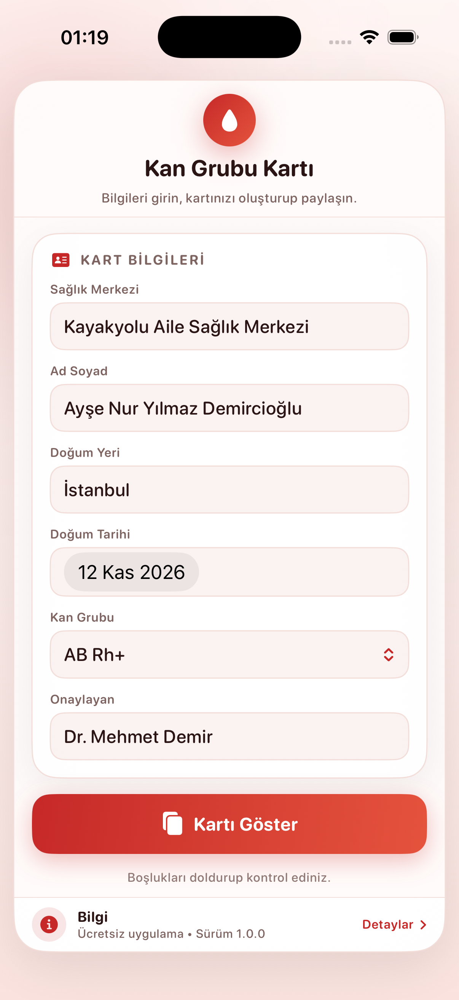
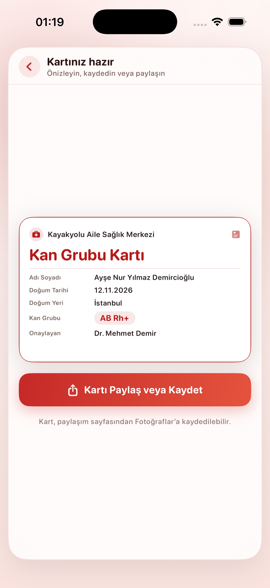
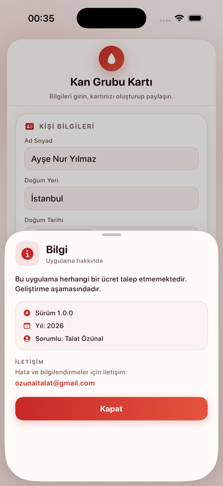

<p align="center">
  
</p>

<h1 align="center">Kan Grubu Kartı</h1>

<p align="center">
  Turn your blood group and basic identity details into a clean, shareable card.<br>
  Fill the form once, preview the card, then save it to Photos or send it in a message.<br>
  Available in Turkish, English, German, French and Italian.
</p>

<p align="center">
  <b>English</b> · <a href="README.tr.md">Türkçe</a>
</p>

<p align="center">
  
  
  
  
</p>

---

## Overview

**Kan Grubu Kartı** (Turkish for *Blood Group Card*) is a small SwiftUI app that creates a personal blood group card. You enter the health centre, your name, place and date of birth, blood group and the approving doctor; the app renders a card as a high-resolution image that can be saved to Photos or shared with family, school, workplace or an emergency contact.

The card is not a replacement for an official medical document. It is a quick, readable summary designed to be kept on a phone or printed from the shared image.

## Why this app exists

In an emergency, blood group is one of the first things a responder may need — yet most people do not carry it visibly. Official cards are issued by health institutions and can take time to replace.

This app makes a **personal, clearly-labelled card** that is easy to regenerate and easy to share:

- **Fill once** — six short fields.
- **Preview instantly** — the card is rendered at 3× (1200 × 750 px) for crisp text when printed or zoomed.
- **Share anywhere** — the iOS share sheet covers Messages, Mail, AirDrop, Photos and printing.
- **No account** — nothing is uploaded; the card exists only while you use the app.

It is a convenience tool, **not** an official identity or medical document.

## Screenshots

<p align="center">
  
  &nbsp;
  
  &nbsp;
  
</p>

<p align="center">
  <sub>Empty form &nbsp;·&nbsp; filled form &nbsp;·&nbsp; rendered card preview</sub>
</p>

<p align="center">
  
</p>

<p align="center">
  <sub>Info sheet with version, year, responsible person, language selector and contact</sub>
</p>

## Features

- **Six-field form** — health centre, name, place of birth, date of birth, blood group and approving doctor.
- **Eight blood groups** — A, B, AB and O, each with Rh+ and Rh−, chosen from a native menu. The card uses the international notation, e.g. `AB Rh+`.
- **Live card preview** — the card is rendered with `ImageRenderer` at 3× and shown scaled to the screen.
- **Share or save** — `ShareLink` opens the system share sheet with the card image; “Save Image” puts it in Photos.
- **Readable card design** — white background, red frame, health-centre header, labelled rows and a blood-group badge.
- **Graceful empty values** — missing fields appear as “—” instead of blank space.
- **Long-name handling** — names shrink to fit on one line instead of overflowing.
- **Single-frame layout** — one rounded card, centered, max width 620 pt; no horizontal overflow on any device.
- **Light & dark mode** — the app chrome adapts; the shared card always stays white for printing.
- **Info bar** — slim footer that opens a sheet with version, year, responsible person, contact and a “Kapat” button.
- **Five languages** — Turkish, English, German, French and Italian, switchable from the info sheet without restarting the app.

## Languages

The interface is available in **Turkish, English, German, French and Italian**. The first launch follows the device language; you can change it at any time from **Bilgi → Dil** without restarting the app. The choice is stored in `UserDefaults` (key `appLanguage`), and the form, card labels, dates and share sheet update immediately. Blood group values use the universal notation (`A Rh+`, `AB Rh−`, …) and need no translation.

Turkish is the development language, so it is also the fallback: if a key is missing in the selected language, the Turkish text is shown.

### Adding a new language

1. Duplicate one of the `<code>.lproj` folders (for example `en.lproj`) and rename it to the new language code.
2. Translate `Localizable.strings` and `InfoPlist.strings`, keeping the keys unchanged.
3. Add the code to `Yerellestirme.desteklenenDiller` and a case to `UygulamaDili` in `Dil.swift`.
4. Add the language to `knownRegions` in the Xcode project.

No storyboard or asset changes are needed.

## How to use

Button names in this README are shown in Turkish; the app uses the same terms in the selected language.

1. Open the app and fill in **Sağlık Merkezi**, **Ad Soyad**, **Doğum Yeri**, **Doğum Tarihi**, **Kan Grubu** and **Onaylayan**. **Sağlık Merkezi** is required: **Kartı Göster** stays disabled and a short hint is shown until it is filled in.
2. Tap **Kartı Göster**. The card preview appears, centered on the screen.
3. Tap **Kartı Paylaş veya Kaydet**.
4. In the share sheet choose **Save Image** to keep it in Photos, or send it via Messages, Mail or AirDrop.
5. To create a different card, go back with the chevron button and edit the fields.
6. Tap the **Bilgi** bar at the bottom for version and contact details.
7. To change the language, tap **Bilgi**, choose a language under **Dil**, then close the sheet — the form and the card update instantly.

### Card contents

| Row | Source |
|---|---|
| Sağlık Merkezi | Health centre field (shown as the card header) |
| Title | “Kan Grubu Kartı” |
| Adı Soyadı | Name field |
| Doğum Tarihi | Date picker, formatted according to the selected language |
| Doğum Yeri | Place of birth field |
| Kan Grubu | Selected blood group, shown as a red badge (e.g. `AB Rh+`) |
| Onaylayan | Approving doctor field |

## Data & privacy

- The form lives in memory only; the app stores **no personal data** between launches and makes **no network requests**.
- The card image is generated on the device. It leaves the app only when you pick a destination in the share sheet.
- Screenshots or saved images are handled by iOS Photos and the apps you share them with.

## Info bar

The footer at the bottom of the main frame is persistent and small. Tapping it opens a sheet with:

- “Bu uygulama herhangi bir ücret talep etmemektedir. Geliştirme aşamasındadır.”
- Version **1.0.0**, year **2026**, responsible **Talat Özünal**
- A language selector (**Sistem** plus the five languages) that applies immediately
- Contact: **ozunaltalat@gmail.com** (opens the Mail app)
- A **Kapat** button

## Tech stack

| Layer | Choice |
|---|---|
| UI | SwiftUI |
| State | `@State` bindings |
| Card rendering | `ImageRenderer` at scale 3.0 → 1200 × 750 px |
| Sharing | `ShareLink` with `SharePreview` |
| Typography | SF Rounded, 11–27 pt |
| Palette | Red → coral gradient (`#C62828` → `#E5533D`), warm rose surfaces |
| Dependencies | None |
| Minimum target | iOS 16.0 |
| Devices | iPhone and iPad (adaptive, max width 620 pt) |

## Project structure

```
Kan Grubu Kartı/
├── Kan Grubu Kartı.xcodeproj
├── Kan Grubu Kartı/
│   ├── KanGrubuKartiApp.swift    # App entry point
│   ├── ContentView.swift         # Theme + form screen
│   ├── KanGrubuSyf.swift         # Blood group picker
│   ├── İkiniSayfa.swift          # Card design, rendering and sharing
│   ├── BilgiBari.swift           # Info bar + info sheet
│   ├── Dil.swift                 # Language manager + language selector
│   ├── tr.lproj … it.lproj/      # Localizable.strings + InfoPlist.strings
│   └── Assets.xcassets           # App icon and accent color
├── docs/
│   ├── icon.png
│   └── screenshots/
├── README.md                     # English
└── README.tr.md                  # Turkish
```

### Main types

- `Tema` — dynamic light/dark colors and the red/coral gradient.
- `ContentView` — the form and navigation to the card screen.
- `KanGrubuSecici` — native menu for the eight blood groups.
- `ikinciSayfa` — card layout, `ImageRenderer` output and share button.
- `BilgiBari` / `BilgiSayfasi` — footer bar and info sheet.
- `Yerellestirme` / `DilSecici` — language selection persisted in `UserDefaults` and the in-app language menu.

## Requirements

- macOS with **Xcode 16 or newer** (the project uses the modern synchronized-folder format).
- iOS **16.0+** simulator or device.
- No CocoaPods, Swift Package Manager packages or other setup.

## Build & run

```bash
git clone https://github.com/talatozunal/Kan-Grubu-Karti.git
cd Kan-Grubu-Karti
open "Kan Grubu Kartı.xcodeproj"
```

Select the **Kan Grubu Kartı** scheme and run on an iPhone simulator or a device.

For a device build, set your own **Team** under *Signing & Capabilities*. The bundle identifier is `com.talatev.KanGrubuKarti`; change it if it conflicts with your account.

Command-line build:

```bash
xcodebuild -project "Kan Grubu Kartı.xcodeproj" \
  -scheme "Kan Grubu Kartı" \
  -destination 'generic/platform=iOS Simulator' build
```

## Notes & limitations

- The app does not verify the entered information. The card is only as accurate as what you type.
- The approving doctor field is free text; the card is not validated or signed by that person.
- There is no saved-card history — regenerate the image whenever you need it.
- The card header comes from the **Sağlık Merkezi** field; no institution is hardcoded, so the same build works for any clinic or workplace.
- The project is under active development; the in-app info sheet says so.

## Disclaimer

This card is a personal summary, **not** an official medical or identity document. Do not rely on it for diagnosis, treatment or emergency decisions. In a medical emergency, contact emergency services and let healthcare professionals determine your blood group through proper testing.

## License

Released under the [MIT License](LICENSE). © 2026 Talat Özünal.

## Contact

Questions, bug reports and suggestions: **ozunaltalat@gmail.com**
