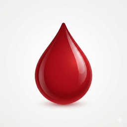
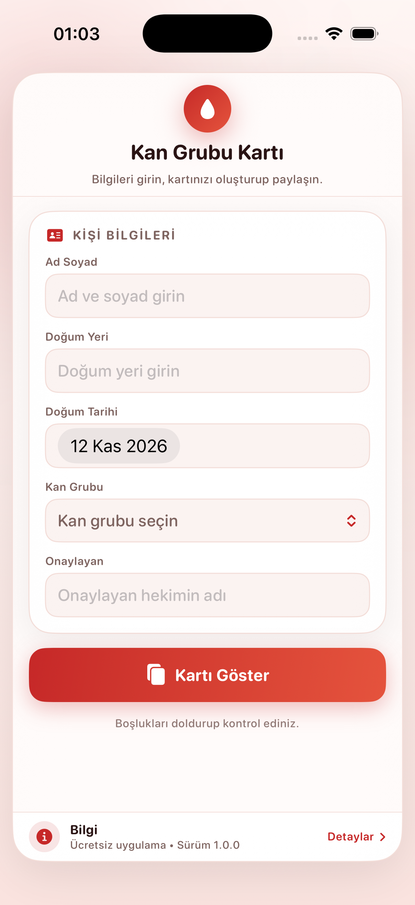
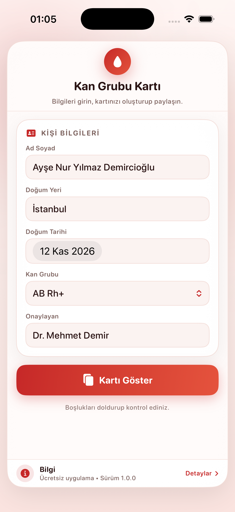
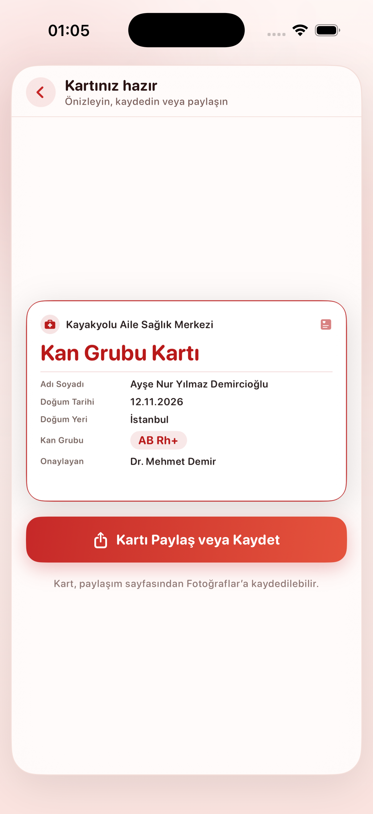
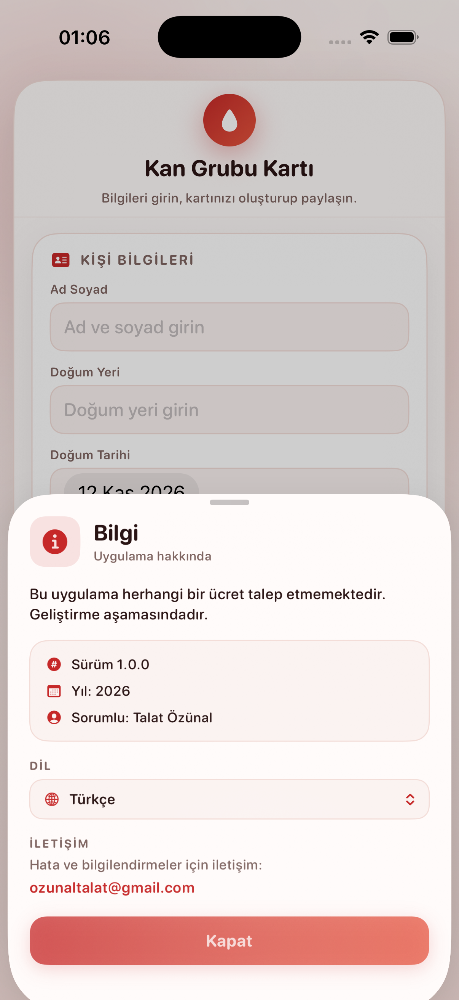

<p align="center">
  
</p>

<h1 align="center">Kan Grubu Kartı</h1>

<p align="center">
  Kan grubunuzu ve temel kimlik bilgilerinizi temiz, paylaşılabilir bir karta dönüştürün.<br>
  Formu bir kez doldurun, kartı önizleyin; Fotoğraflar'a kaydedin veya mesajla gönderin.<br>
  Türkçe, İngilizce, Almanca, Fransızca ve İtalyanca olarak kullanılabilir.
</p>

<p align="center">
  <a href="README.md">English</a> · <b>Türkçe</b>
</p>

<p align="center">
  
  
  
  
</p>

---

## Genel bakış

**Kan Grubu Kartı**, kişisel bir kan grubu kartı oluşturan küçük bir SwiftUI uygulamasıdır. Ad soyad, doğum yeri, doğum tarihi, kan grubu ve onaylayan hekim bilgilerini girersiniz; uygulama kartı yüksek çözünürlüklü bir görsel olarak oluşturur. Görsel Fotoğraflar'a kaydedilebilir veya aile, okul, iş yeri ya da acil durum kişisiyle paylaşılabilir.

Kart, resmî bir tıbbi belgenin yerini tutmaz. Telefonda taşınmak veya paylaşılan görselden yazdırılmak üzere tasarlanmış, hızlı ve okunaklı bir özettir.

## Bu uygulama neden var?

Acil bir durumda kan grubu, müdahale eden kişinin ilk ihtiyaç duyabileceği bilgilerden biridir; ancak çoğu insan kan grubunu görünür biçimde taşımaz. Resmî kartlar sağlık kurumları tarafından düzenlenir ve yenilenmesi zaman alabilir.

Bu uygulama, **yeniden oluşturulması ve paylaşılması kolay, açıkça etiketlenmiş kişisel bir kart** sunar:

- **Bir kez doldur** — beş kısa alan.
- **Anında önizle** — kart, yazdırıldığında veya yakınlaştırıldığında net görünsün diye 3× (1200 × 750 px) oluşturulur.
- **Her yerde paylaş** — iOS paylaşım sayfası Mesajlar, Mail, AirDrop, Fotoğraflar ve yazdırmayı kapsar.
- **Hesap yok** — hiçbir şey yüklenmez; kart yalnızca uygulamayı kullandığınız sürece vardır.

Bu bir kolaylık aracıdır; **resmî kimlik veya tıbbi belge değildir**.

## Ekran görüntüleri

<p align="center">
  
  &nbsp;
  
  &nbsp;
  
</p>

<p align="center">
  <sub>Boş form &nbsp;·&nbsp; doldurulmuş form &nbsp;·&nbsp; oluşturulan kart önizlemesi</sub>
</p>

<p align="center">
  
</p>

<p align="center">
  <sub>Sürüm, yıl, sorumlu, dil seçici ve iletişim bilgisini gösteren bilgi paneli</sub>
</p>

## Özellikler

- **Beş alanlı form** — ad soyad, doğum yeri, doğum tarihi, kan grubu ve onaylayan hekim.
- **Sekiz kan grubu** — A, B, AB ve O'nun Rh+ ve Rh− seçenekleri, yerel menüden seçilir. Kartta uluslararası gösterim kullanılır, ör. `AB Rh+`.
- **Canlı kart önizlemesi** — kart `ImageRenderer` ile 3× oluşturulur ve ekrana ölçeklenerek gösterilir.
- **Paylaş veya kaydet** — `ShareLink` sistem paylaşım sayfasını kart görseliyle açar; “Görseli Kaydet” ile Fotoğraflar'a eklenir.
- **Okunaklı kart tasarımı** — beyaz zemin, kırmızı çerçeve, sağlık merkezi başlığı, etiketli satırlar ve kan grubu rozeti.
- **Boş değer yönetimi** — eksik alanlar boşluk yerine “—” olarak görünür.
- **Uzun ad desteği** — uzun adlar taşmak yerine tek satırda küçültülerek sığar.
- **Tek çerçeve düzeni** — tek yuvarlatılmış kart, ortalanmış, en fazla 620 pt genişlik; hiçbir cihazda yatay taşma olmaz.
- **Açık ve koyu mod** — uygulama arayüzü uyum sağlar; paylaşılan kart yazdırma için her zaman beyaz kalır.
- **Bilgi barı** — alt kenardaki ince şerit; sürüm, yıl, sorumlu, iletişim ve “Kapat” butonunu içeren paneli açar.
- **Beş dil** — Türkçe, İngilizce, Almanca, Fransızca ve İtalyanca; bilgi panelinden uygulama yeniden başlatılmadan değiştirilebilir.

## Diller

Arayüz **Türkçe, İngilizce, Almanca, Fransızca ve İtalyanca** olarak kullanılabilir. İlk açılışta cihaz dili esas alınır; dilediğiniz zaman **Bilgi → Dil** bölümünden uygulamayı yeniden başlatmadan değiştirebilirsiniz. Seçim `UserDefaults` (anahtar: `appLanguage`) içinde saklanır; form, kart etiketleri, tarihler ve paylaşım sayfası anında güncellenir. Kan grubu değerleri evrensel gösterimi (`A Rh+`, `AB Rh−`, …) kullandığı için çeviri gerektirmez.

Geliştirme dili Türkçe olduğu için yedek dil de Türkçedir: seçili dilde bir anahtar eksikse Türkçe metin gösterilir.

### Yeni dil ekleme

1. `<kod>.lproj` klasörlerinden birini (örneğin `en.lproj`) kopyalayıp yeni dil koduna göre adlandırın.
2. `Localizable.strings` ve `InfoPlist.strings` dosyalarını anahtarları değiştirmeden çevirin.
3. `Dil.swift` içindeki `Yerellestirme.desteklenenDiller` listesine kodu, `UygulamaDili` enum'una da bir case ekleyin.
4. Xcode projesindeki `knownRegions` listesine dili ekleyin.

Storyboard veya görsel değişikliği gerekmez.

## Nasıl kullanılır?

Bu belgedeki buton adları Türkçe gösterilmiştir; uygulama seçili dilde aynı terimleri kullanır.

1. Uygulamayı açın ve **Ad Soyad**, **Doğum Yeri**, **Doğum Tarihi**, **Kan Grubu** ve **Onaylayan** alanlarını doldurun.
2. **Kartı Göster** butonuna dokunun. Kart önizlemesi ekranın ortasında görünür.
3. **Kartı Paylaş veya Kaydet** butonuna dokunun.
4. Paylaşım sayfasında **Görseli Kaydet** ile Fotoğraflar'a kaydedin veya Mesajlar, Mail ya da AirDrop ile gönderin.
5. Farklı bir kart oluşturmak için geri okuyla dönüp alanları düzenleyin.
6. Sürüm ve iletişim bilgileri için alttaki **Bilgi** barına dokunun.
7. Dili değiştirmek için **Bilgi** barına dokunun, **Dil** bölümünden bir dil seçin ve paneli kapatın — form ve kart anında güncellenir.

### Kart içeriği

| Satır | Kaynak |
|---|---|
| Üst başlık | “Kayakyolu Aile Sağlık Merkezi” |
| Kart başlığı | “Kan Grubu Kartı” |
| Adı Soyadı | Ad soyad alanı |
| Doğum Tarihi | Tarih seçici, seçili dile göre biçimlendirilir |
| Doğum Yeri | Doğum yeri alanı |
| Kan Grubu | Seçilen kan grubu, kırmızı rozet olarak (ör. `AB Rh+`) |
| Onaylayan | Onaylayan hekim alanı |

## Veri ve gizlilik

- Form yalnızca bellekte tutulur; uygulama açılışlar arasında **hiçbir kişisel veriyi saklamaz** ve **hiçbir ağ isteği yapmaz**.
- Kart görseli cihazda oluşturulur. Yalnızca paylaşım sayfasında bir hedef seçtiğinizde uygulamadan ayrılır.
- Kaydedilen görseller ve ekran görüntüleri iOS Fotoğraflar ve paylaştığınız uygulamalar tarafından yönetilir.

## Bilgi barı

Ana çerçevenin altındaki şerit kalıcı ve küçüktür. Dokunulduğunda şunları içeren panel açılır:

- “Bu uygulama herhangi bir ücret talep etmemektedir. Geliştirme aşamasındadır.”
- Sürüm **1.0.0**, yıl **2026**, sorumlu **Talat Özünal**
- Anında uygulanan bir dil seçici (**Sistem** ve beş dil)
- İletişim: **ozunaltalat@gmail.com** (Mail uygulamasını açar)
- **Kapat** butonu

## Teknik yapı

| Katman | Seçim |
|---|---|
| Arayüz | SwiftUI |
| Durum | `@State` bağlamaları |
| Kart oluşturma | `ImageRenderer`, 3.0 ölçek → 1200 × 750 px |
| Paylaşım | `ShareLink` + `SharePreview` |
| Tipografi | SF Rounded, 11–27 pt |
| Palet | Kırmızı → mercan geçişi (`#C62828` → `#E5533D`), sıcak gül yüzeyler |
| Bağımlılıklar | Yok |
| Minimum hedef | iOS 16.0 |
| Cihazlar | iPhone ve iPad (uyarlanabilir, en fazla 620 pt genişlik) |

## Proje yapısı

```
Kan Grubu Kartı/
├── Kan Grubu Kartı.xcodeproj
├── Kan Grubu Kartı/
│   ├── KanGrubuKartiApp.swift    # Uygulama giriş noktası
│   ├── ContentView.swift         # Tema + form ekranı
│   ├── KanGrubuSyf.swift         # Kan grubu seçici
│   ├── İkiniSayfa.swift          # Kart tasarımı, oluşturma ve paylaşım
│   ├── BilgiBari.swift           # Bilgi barı + bilgi paneli
│   ├── Dil.swift                 # Dil yöneticisi + dil seçici
│   ├── tr.lproj … it.lproj/      # Localizable.strings + InfoPlist.strings
│   └── Assets.xcassets           # Uygulama simgesi ve vurgu rengi
├── docs/
│   ├── icon.png
│   └── screenshots/
├── README.md                     # İngilizce
└── README.tr.md                  # Türkçe
```

### Ana tipler

- `Tema` — dinamik açık/koyu renkler ve kırmızı/mercan geçişi.
- `ContentView` — form ve kart ekranına geçiş.
- `KanGrubuSecici` — sekiz kan grubu için yerel menü.
- `ikinciSayfa` — kart düzeni, `ImageRenderer` çıktısı ve paylaşım butonu.
- `BilgiBari` / `BilgiSayfasi` — alt bar ve bilgi paneli.
- `Yerellestirme` / `DilSecici` — `UserDefaults` içinde saklanan dil seçimi ve uygulama içi dil menüsü.

## Gereksinimler

- macOS ve **Xcode 16 veya üzeri** (proje yeni senkronize klasör biçimini kullanır).
- iOS **16.0+** simülatör veya cihaz.
- CocoaPods, Swift Package Manager paketi veya ek kurulum gerekmez.

## Derleme ve çalıştırma

```bash
git clone https://github.com/talatozunal/Kan-Grubu-Karti.git
cd Kan-Grubu-Karti
open "Kan Grubu Kartı.xcodeproj"
```

**Kan Grubu Kartı** şemasını seçip bir iPhone simülatöründe veya cihazda çalıştırın.

Cihazda çalıştırmak için *Signing & Capabilities* altında kendi **Team**'inizi seçin. Paket kimliği `com.talatev.KanGrubuKarti`; hesabınızla çakışırsa değiştirebilirsiniz.

Komut satırından derleme:

```bash
xcodebuild -project "Kan Grubu Kartı.xcodeproj" \
  -scheme "Kan Grubu Kartı" \
  -destination 'generic/platform=iOS Simulator' build
```

## Notlar ve sınırlamalar

- Uygulama girilen bilgileri doğrulamaz. Kart, yalnızca yazdığınız kadar doğrudur.
- Onaylayan hekim alanı serbest metindir; kart o hekim tarafından doğrulanmış veya imzalanmış sayılmaz.
- Kayıtlı kart geçmişi yoktur — ihtiyaç duyduğunuzda görseli yeniden oluşturun.
- “Kayakyolu Aile Sağlık Merkezi” başlığı kart tasarımının parçasıdır; farklı bir kurum kullanıyorsanız her dilin `Localizable.strings` dosyasındaki `kg.kartMerkez` anahtarını değiştirebilirsiniz.
- Proje geliştirme aşamasındadır; uygulama içindeki bilgi paneli de bunu belirtir.

## Sorumluluk reddi

Bu kart kişisel bir özettir; **resmî tıbbi veya kimlik belgesi değildir**. Teşhis, tedavi veya acil durum kararları için buna dayanmayın. Tıbbi bir acil durumda acil servislere başvurun ve kan grubunuzun uygun testlerle sağlık profesyonelleri tarafından belirlenmesini sağlayın.

## Lisans

[MIT Lisansı](LICENSE) ile yayımlanmıştır. © 2026 Talat Özünal.

## İletişim

Soru, hata bildirimi ve öneriler: **ozunaltalat@gmail.com**
